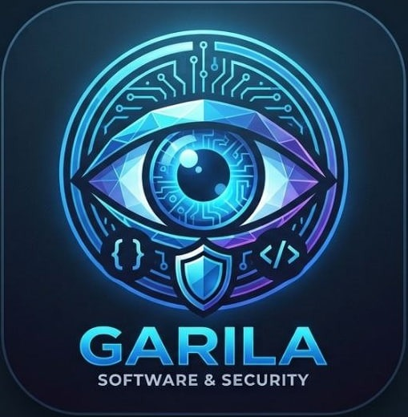
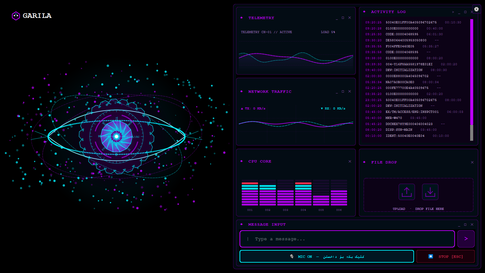

# 🤖 GARILA AI — Autonomous Tactical Desktop Assistant
### یەکەمین یاریدەدەری زیرەکی دەستکردی دەنگی و ئۆتۆنۆم بە زمانی کوردی

<p align="center">
  
</p>

<p align="center">
  <a href="https://github.com"></a>
  <a href="https://github.com"></a>
  <a href="https://github.com"></a>
  <a href="https://github.com"></a>
</p>

---

## 📸 ڕووکاری بەرنامەکە / User Interface Preview

<p align="center">
  
</p>

---

## 🌟 دەربارەی پڕۆژەکە (About GARILA)

**GARILA (گارێلا)** سیستمێکی زیرەکی دەستکردی پێشکەوتووی سەربەخۆیە (Autonomous AI Assistant) کە لەسەر مۆدێلە ڕاستەوخۆکانی دەنگی (Google Gemini Live API) بنیاتنراوە. گارێلا بە شێوازێکی سروشتی لە زمانی کوردی (سۆرانی) تێدەگات، بە کوردی وەڵام دەداتەوە، و کۆنترۆڵی تەواوی کۆمپیوتەرەکەت دەکات لە ڕێگەی دەنگ، نووسین و بینینی شاشە.

GARILA is an autonomous tactical desktop AI assistant featuring a sleek 60 FPS glassmorphic HUD, real-time voice streaming powered by the Google Gemini Live API, autonomous OS & developer capabilities, and dynamic topic-driven theming.

---

## 🚀 تایبەتمەندییە سەرەکییەکان (Key Features)

### ١. 🎙️ گفتوگۆی دەنگیی ڕاستەوخۆ بە کوردی (Real-Time Voice)
* گفتوگۆی ڕاستەوخۆ بە زمانی کوردی (سۆرانی) بەبێ دواکەوتن (Ultra-low latency).
* ناسینەوەی تێرم و دەستەواژە تەکنیکییەکان و وەڵامدانەوەی خێرا.

### ٢. 👁️ چاوی سایبەری هۆلۆگرامی (Holographic Cyber Eye)
* خاوەنی چاوێکی میکانیکیی زیندووە (Interactive Cyber Eye) کە لە ٨ بەشی ئاڵۆز پێکدێت (Aperture blades, Data rings, Orbital particles, Digital gear cogs).
* کارلێک لەگەڵ ئاستی دەنگ و شێوازی قسەکردن دەکات بە ٦٠ فریم لە چرکەیەکدا.

### ٣. 🎨 سیستەمی ڕەنگگۆڕی دینامیکی (50 Dynamic Themes)
* بەپێی ٥٠ بابەتی جیاواز لە گفتوگۆکەدا (وەک تەکنەلۆژیا، مێژوو، سایبەر، پزیشکی، ئیسلامی، دارایی، وەرزش، فەلسەفە و هتد)، تەواوی ڕووکاری بەرنامەکە و چاوی سایبەرەکە ڕەنگی خۆیان لە یەک چرکەدا دەگۆڕن.

### ٤. 💻 کۆنترۆڵی کۆمپیوتەر و ئەندازیاری کۆد (Dev Agent & OS Automation)
* **Dev Agent:** توانای دروستکردن و پەرەپێدانی پڕۆژە لەسەر Desktop، تێستکردن و چاککردنی باگەکان.
* **Computer Control:** جوڵاندنی ماوس، نووسین لەناو بەرنامەکان، کردنەوەی تێرمیناڵ و ئەپڵیکەیشنەکانی ویندۆز.
* **Live Vision:** وێنەگرتنی شاشە و کامێرا بۆ شیکاریکردنی وێنە و بەڵگەنامە و چارتەکان.

### ٥. 🛡️ ئاسایش و پاراستنی نهێنی (Security & Privacy Guard)
* **Confirmation Gate:** هیچ فەرمانێکی مەترسیدار (وەک کوژاندنەوە، سڕینەوە، یان دەستکاری فایل) جێبەجێ ناکات تا خۆت بە کلیک ڕەزامەندی نەدەیت.
* **Local Storage:** داتاکان، بیرگە و ڕێکخستنەکان لە ناوخۆی کۆمپیوتەری خۆت هەڵدەگیرێن.

---

## 📥 داگرتن و کارپێکردن (Download & Getting Started)

### بۆ بەکارهێنەرانی ویندۆز (Standalone .exe):
1. لە بەشی [**Releases**](https://github.com) فایلی **`GARILA.exe`** داببەزێنە.
2. کلیک لەسەر فایلی `GARILA.exe` بکە بۆ کردنەوەی ڕاستەوخۆ (پێویستی بە هیچ دامەزراندنێک نییە).
3. لە یەکەم کردنەوەدا، کلیلی **Gemini API** داخڵ بکە (دەتوانیت لە ڕێگەی دوگمەی ناو بەرنامەکە بە خۆڕایی وەریبگریت لە Google AI Studio).

### بۆ گەشەپێدەران (Running from Source):
```bash
# کلۆنکردنی پڕۆژەکە
git clone https://github.com/YOUR_USERNAME/GARILA.git
cd GARILA

# دامەزراندنی پاکێجە پێویستەکان
pip install -r requirements.txt

# کارپێکردن
python main.py
```

---

## 🔑 بەدەستهێنانی کلیلی خۆڕایی (Get Free Gemini API Key)
بۆ بەکارهێنانی GARILA، پێویستت بە کلیلێکی بەخۆڕایی مۆدێلی Gemini هەیە:
1. سەردانی [Google AI Studio](https://aistudio.google.com/apikey) بکە.
2. بە ئەکاونتی گۆگڵت چووبچۆ ژوورەوە و کلیک لەسەر **"Create API key"** بکە.
3. کلیلەکە کۆپی بکە و لە پەنجەرەی پێشوازیی GARILA دایبنێ.

---

## 👥 گەشەپێدەر و خاوەندارێتی (Developer & License)
* پەرەپێدراوە لەلایەن: **G4RIL4**
* بڵاوکراوە لەژێر مۆڵەتی: [MIT License](LICENSE)
